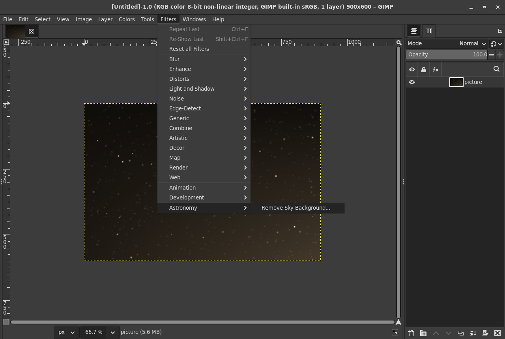

# gegl-astro

Astrophotography finishing tools for GIMP 3 as GEGL operations: sky
gradient removal, star mask, star reduction, star colour and astro
stretches, as editable (non-destructive) filters under
**Filters > Astronomy**.

**Status: in progress.** Working: `astro:background` (Remove Sky
Background, first version), `astro:stretch` (Astro Stretch: GHS and
arcsinh), `astro:star-mask` (Star Mask) and `astro:star-reduce` (Reduce
Stars). The others are designed in [PLAN.md](PLAN.md) and being built. The
research behind it (Georg Hennig's GIMP 2 astronomy plug-ins, Siril,
the methods, licences, patents) is in [docs/research.md](docs/research.md).



## Remove Sky Background (`astro:background`), first version

Fits a smooth surface to the sky between the stars and subtracts it
(light pollution, sky glow) or divides by it (vignetting); the sky keeps
its mean brightness. The sky level is measured on a grid of cells with
sigma-clipped medians, so stars do not count; cells much brighter than
the rest (nebulae, galaxies) and cells far off the fitted surface are
left out. The surface is a polynomial of degree 0 to 4. "Show: background
model" shows the fitted surface itself.


On synthetic star fields (`tests/check.c`), the fitted surface is
within 0.5 % of a known quadratic gradient's amplitude, star flux is
kept to 0.05 %, and a nebula as bright as the gradient moves the surface
by 2.2 %. Large nebulae that fill much of the frame, and gradients that
change within a few cells (near a horizon), need the planned spline
surface and sample points (PLAN.md).

"Leave out stars" samples the sky between the stars of the star mask
(below), for dense star fields such as the Milky Way, where stars fill
so much of each cell that they raise its sky level: on a synthetic band
of 9600 stars the model error drops from 21 % to 3 % of the gradient.

The filter needs the whole layer (the fit depends on all of it), so a
changed setting recomputes the whole layer: 0.12 s on a 24 megapixel
image here (1.07 s with the stars left out).

## Astro Stretch (`astro:stretch`)

Filters > Astronomy > Stretch... brings out the faint parts of linear
data (a stacked image from Siril or DeepSkyStacker, before any
stretching):

- **Generalised hyperbolic stretch (GHS)**, with its five settings:
  stretch (ln (D + 1)), local intensity (b), symmetry point, shadow and
  highlight protection, and the inverse transform. The maths is ported
  from Siril's `ght.c`; the same numbers as Siril's GHS command give the
  same curve.
- **Arcsinh stretch** (Lupton et al. 2004) with one strength.
- A black point, and colour kept (one factor from the luminance for all
  three channels) or each channel stretched alone.
- Automatic black point and symmetry point from the image's median and
  noise (then the filter reads the whole layer).

The curves match an independent implementation of the published GHS
equations to under 1e-6 (tests/stretch-reference.py). The filter works
in linear light, so on a linear image the result looks brighter than the
same settings in Siril, which shows its numbers as they are (PLAN.md,
question 7).

## Star Mask (`astro:star-mask`) and Reduce Stars (`astro:star-reduce`)

**Star Mask** marks the stars (white) and nothing else: small,
concentrated points of light above the noise. Wide structures (nebulae,
galaxy cores, anything wider than "Largest star" at half its peak) are
left out, and stars on a nebula are still found. Show it as a grey mask
(to copy into a layer mask) or in red over the image.

**Reduce Stars** makes the stars smaller and fainter under that mask
with a morphological filter (erosion, or a gentler rank "selection"),
so nebulae and galaxies stand out. Outside the mask not a single pixel
changes, the result never goes below the local sky (no dark rings), and
"Keep star colour" shrinks the brightness only.

On synthetic star fields (tests/check-stars.c): every star with a peak
of at least 12 noise sigmas is found, about 4 false detections per
megapixel of pure noise; the default reduction takes the stars' FWHM to
0.87 x, erosion at 100 % to 0.66 x. Both filters need the whole layer;
on 24 megapixels, Star Mask takes 1.0 s and Reduce Stars 1.2 s here.

## Build and install

Needs GEGL 0.4.62 or newer and babl with their development files,
meson and a C compiler; for use in GIMP, the native GIMP 3. On Debian and
Ubuntu:

```sh
sudo apt install gimp libgimp-3.0-dev meson ninja-build
```

For your own user, into `~/.local/share/gegl-0.4/plug-ins`, where GIMP
loads GEGL operations from at start:

```sh
meson setup build -Dmoduledir=$HOME/.local/share/gegl-0.4/plug-ins
ninja -C build install
```

or the same through `../gimp-devtools/gimp-build.sh`, which finds that
folder (`$GEGL_OPDIR`):

```sh
../gimp-devtools/gimp-build.sh . 'meson setup build -Dmoduledir=$GEGL_OPDIR && ninja -C build install'
```

Without `-Dmoduledir`, `ninja -C build install` installs into GEGL's
system folder of operations.

## Tests

All tests run isolated from your own GIMP folders (`tests/isolate.sh`, a
copy of `gimp-devtools/isolate.sh`: a throwaway home and profile in
`tests/output`) and check that nothing in your folders of GIMP and other
apps changed.

- `tests/check.sh`: builds against the system's GEGL and runs the
  numerical checks on synthetic star fields, again under AddressSanitizer
  and UndefinedBehaviorSanitizer (`tests/check.sh quick`: without).
  The GHS results are also checked against an independent Python
  implementation of the published equations (`tests/stretch-reference.py`).
- `tests/gimp-check.sh`: the filters in the native GIMP without a window:
  a non-destructive filter on every precision and grayscale, settings
  kept through XCF, the same pixels as plain GEGL and the `gegl` command
  line (skipped without the `gegl` command, on Debian and Ubuntu the
  package `gegl`).
- `tests/bench.sh`: how long each filter takes on a 24 megapixel
  synthetic star field.
- `tests/gui/dialogs.sh`: opens each filter's dialog from Search
  Actions in GIMP on a Broadway display and leaves screenshots in
  `tests/output/gui`.
- `tests/gui/look.sh [steps]`: GIMP (`--new-instance`) on a Broadway
  display with a generated star field, driven by a headless Chrome
  (`gimp-devtools/gui/cdp.mjs`), leaves a screenshot in
  `tests/output/gui/look.png`.

No test image is a photo: the star fields are generated.

## Credits and licence

GPL-3.0-or-later (COPYING).

The GHS in `astro:stretch` is ported from Siril's `src/filters/ght.c`
(GPL-3.0-or-later; Copyright (C) 2005-2011 Francois Meyer, Copyright (C)
2012-2026 team free-astro, <https://siril.org>), with its copyright lines
kept in `operations/stretch.c`. The GHS equations are by Dave Payne and
Mike Cranfield (<https://www.ghsastro.co.uk>). The arcsinh stretch follows
Lupton et al., "Preparing Red-Green-Blue Images from CCD Data" (2004).

The sampling of `astro:background` follows
Georg Hennig's Background Gradient plug-in (gimp-plugin-astronomy,
GPL-2.0-or-later) and the sample rejection Siril's background extraction
(GPL-3.0-or-later); no code of either is copied into it. The test harness
follows gegl-presence.
