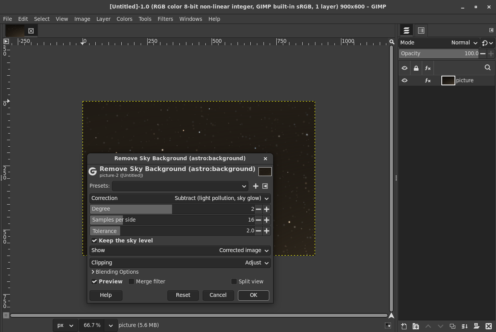

# gegl-astro

Astrophotography finishing tools for GIMP 3 as GEGL operations: sky
gradient removal, star mask, star reduction, star colour and astro
stretches, as editable (non-destructive) filters under
**Filters > Astronomy**.

**Status: skeleton.** One operation works as a first version,
`astro:background` (Remove Sky Background). The others are designed in
[PLAN.md](PLAN.md), which is up for review before they are built. The
research behind it (Georg Hennig's GIMP 2 astronomy plug-ins, Siril,
the methods, licences, patents) is in [docs/research.md](docs/research.md).


## Remove Sky Background (`astro:background`), first version

Fits a smooth surface to the sky between the stars and subtracts it
(light pollution, sky glow) or divides by it (vignetting); the sky keeps
its mean brightness. The sky level is measured on a grid of cells with
sigma-clipped medians, so stars do not count; cells much brighter than
the rest (nebulae, galaxies) and cells far off the fitted surface are
left out. The surface is a polynomial of degree 0 to 4. "Show: background
model" shows the fitted surface itself.



On synthetic star fields (`tests/check.c`), the fitted surface is
within 0.5 % of a known quadratic gradient's amplitude, star flux is
kept to 0.05 %, and a nebula as bright as the gradient moves the surface
by 2.2 %. Large nebulae that fill much of the frame, and gradients that
change within a few cells (near a horizon), need the planned spline
surface and sample points (PLAN.md).

The filter needs the whole layer (the fit depends on all of it), so a
changed setting recomputes the whole layer.

## Build and install

Needs GEGL 0.4.62 or newer and babl, meson and a C compiler.

```sh
meson setup build
ninja -C build
ninja -C build install   # into GEGL's system folder of operations
```

For your own user, or for the Flatpak GIMP, build in the Flatpak's SDK
with `../gimp-devtools/gimp-build.sh` and install into the user's folder
of GEGL operations:

```sh
../gimp-devtools/gimp-build.sh . 'meson setup build -Dmoduledir=$GEGL_OPDIR && ninja -C build install'
```

(`$GEGL_OPDIR` is `~/.var/app/org.gimp.GIMP/data/gegl-0.4/plug-ins` for
the Flatpak, `~/.local/share/gegl-0.4/plug-ins` otherwise.)

## Tests

All tests run isolated from your own GIMP folders (`tests/isolate.sh`, a
copy of `gimp-devtools/isolate.sh`: a throwaway home and profile in
`tests/output`) and check that nothing in your folders of GIMP and other
apps changed.

- `tests/check.sh`: builds in the Flatpak GIMP's SDK and runs the
  numerical checks on synthetic star fields, again under AddressSanitizer
  and UndefinedBehaviorSanitizer (`tests/check.sh quick`: without).
- `tests/gimp-check.sh`: the filter in headless GIMP 3.2.6: a
  non-destructive filter on every precision and grayscale, settings kept
  through XCF, the same pixels as plain GEGL and the `gegl` command line.
- `tests/gui/look.sh [steps]`: GIMP (`--new-instance`) on a Broadway
  display with a generated star field, driven by a headless Chrome
  (`gimp-devtools/gui/cdp.mjs`), leaves a screenshot in
  `tests/output/gui/look.png`.

No test image is a photo: the star fields are generated.

## Credits and licence

GPL-3.0-or-later (COPYING). The sampling of `astro:background` follows
Georg Hennig's Background Gradient plug-in (gimp-plugin-astronomy,
GPL-2.0-or-later) and the sample rejection Siril's background extraction
(GPL-3.0-or-later); no code of either is copied yet. The test harness
follows gegl-presence.
